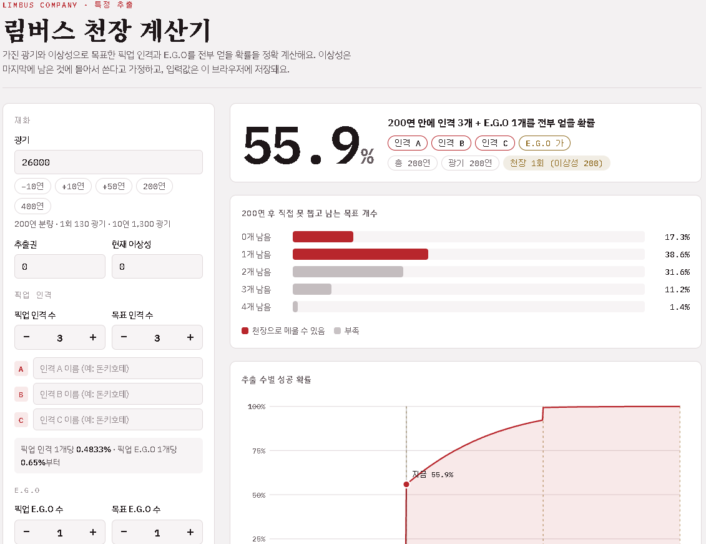

# 림버스 천장 계산기

Limbus Company 특정 추출에서 **가진 광기·추출권·이상성으로 목표한 픽업 인격과 E.G.O를 전부 얻을 확률**을 정확하게 계산하는 웹 페이지입니다.

🔗 **바로 써 보기**: https://jongmin-lee-dev.github.io/limbus-pity-calculator/

<!-- 화면 캡처를 docs/screenshot.png로 저장한 뒤 아래 줄의 주석을 풀어 주세요 -->
<!--  -->

## 만든 이유

새 픽업이 나올 때마다 **"200연 안에 인격이랑 E.G.O까지 다 먹을 수 있을까?"** 가 궁금했습니다.
인격 하나의 확률은 쉽게 계산되지만, 목표가 여러 개가 되고 천장(이상성 200)이 끼면 감으로는 알 수가 없었습니다.

특히 **E.G.O 확률이 이해가 잘 안 됐습니다.** E.G.O 칸은 1.3%인데, 기존 E.G.O를 다 모았는지에 따라 픽업 E.G.O가 0.65%였다가 1.3%가 되고,
뽑는 도중에도 기존 E.G.O가 나올 때마다 확률이 바뀝니다. 이걸 정확히 반영하려고 직접 계산기를 만들었습니다.

## 기능

- **성공 확률**: 지금 재화로 목표 인격 N개 + 목표 E.G.O M개를 전부 얻을 확률
- **남는 개수 분포**: 추출 후 직접 못 뽑고 남는 목표 개수와, 그중 천장으로 메울 수 있는 범위
- **추출 수별 성공 확률 그래프**: 천장이 추가되는 시점 표시, 마우스를 올리면 해당 연차의 확률
- **확률별 필요 연차**: 50% / 80% / 95%에 도달하는 연차와 필요한 광기
- **한 번 돌려보기**: 실제로 한 번 뽑아 보고, 목표를 채우는 순간 멈춰서 남은 광기·추출권·이상성 표시
- **이름 입력**: 목표 인격·E.G.O에 실제 이름을 붙이면 결과와 뽑기 기록에 그 이름으로 표시
- **입력값 저장**: 브라우저(localStorage)에 자동 저장, "기본값으로 되돌리기"로 초기화

## 계산 방식 요약

몬테카를로 추정이 아니라 **동적 계획법으로 정확한 확률**을 구합니다.

- 상태 = (못 뽑은 목표 인격 수, 못 뽑은 목표 E.G.O 수, 못 뽑은 비목표 픽업 E.G.O 수, 못 가진 기존 E.G.O 수)
- 매 추출마다 각 상태의 확률을 다음 상태로 옮기고, 상태에 따라 E.G.O·인격 확률이 바뀌는 것까지 반영
- N연 후 남은 목표 수가 `floor((현재 이상성 + N) / 200)` 이하면 성공 (이상성은 마지막에 몰아 쓰는 게 최적)

자세한 설명은 [docs/how-it-works.md](docs/how-it-works.md)에 있습니다.

### 확률 가정

| 항목 | 값 |
|---|---|
| 픽업 3성 인격 합계 | 1.45% (픽업 인격 수로 균등 분배) |
| 모든 E.G.O 보유 시 픽업 3성 인격 합계 | 1.5% (3성 전체 3.0%) |
| E.G.O 칸 | 1.3% |
| 기존 E.G.O가 남아 있을 때 | 픽업 0.65% + 기존 0.65% |
| 기존 E.G.O 올컬렉 | 픽업 1.3% |
| 픽업 E.G.O를 다 얻은 뒤 | 1.3%가 남은 기존 E.G.O로 |
| 픽업 E.G.O가 여러 개일 때 | 픽업 몫을 아직 없는 픽업 E.G.O끼리 균등 분배 (추정) |
| 1회 추출 | 광기 130, 이상성 +1 |
| 천장 | 이상성 200당 원하는 픽업 1개 교환 |

10연 확정은 1성을 2성으로 바꿀 뿐이라 3성·E.G.O 확률에는 영향이 없어 반영하지 않았습니다.

## 검증

계산이 맞는지 `node --test`로 확인합니다. (Node 18 이상, 추가 설치 없음)

```bash
npm test
```

| 테스트 | 확인 내용 |
|---|---|
| 닫힌 식 비교 | 공식으로 풀리는 경우와 소수점 12자리까지 일치 |
| 몬테카를로 비교 | 2만 번 직접 뽑아 본 성공률이 정확 계산과 통계 오차 안에서 일치 |
| 확률 합 | 매 시점 모든 경우의 확률 합이 1 |
| 검증값 | 아래 표의 값과 일치 |

| 조건 | 200연 | 400연 | 600연 |
|---|---|---|---|
| 인격 4 + E.G.O 1, 기존 E.G.O 5개 남음 | 26.4% | 94.6% | 99.98% |
| 인격 4 + E.G.O 1, 올컬렉 | 32.9% | 96.2% | |

## 구조

```
├── index.html          화면 구성
├── src/
│   ├── calc.js         확률 계산 (화면과 분리, Node에서도 동작)
│   ├── ui.js           입력 처리, 그래프, 한 번 돌려보기
│   └── style.css       스타일 (라이트/다크 모드)
├── test/
│   └── calc.test.js    검증 테스트
└── docs/
    └── how-it-works.md 계산 원리 설명
```

확률이 바뀌면 `src/calc.js` 맨 위 `DEFAULT_CONFIG`만 고치면 됩니다.

## 실행

- `index.html`을 브라우저로 열면 바로 동작합니다. 빌드나 설치가 필요 없습니다.
- GitHub Pages: 저장소 **Settings → Pages**에서 Branch를 `main`, 폴더를 `/ (root)`로 지정

## 기술

HTML · CSS · JavaScript (프레임워크 없음), Node.js 내장 테스트 러너

## 참고

- 비공식 팬 제작 도구입니다. Limbus Company와 관련 이름·상표는 Project Moon에 있습니다.
- 확률은 커뮤니티에 알려진 값을 기준으로 한 가정이라 인게임 **확률 정보**와 다를 수 있습니다.
